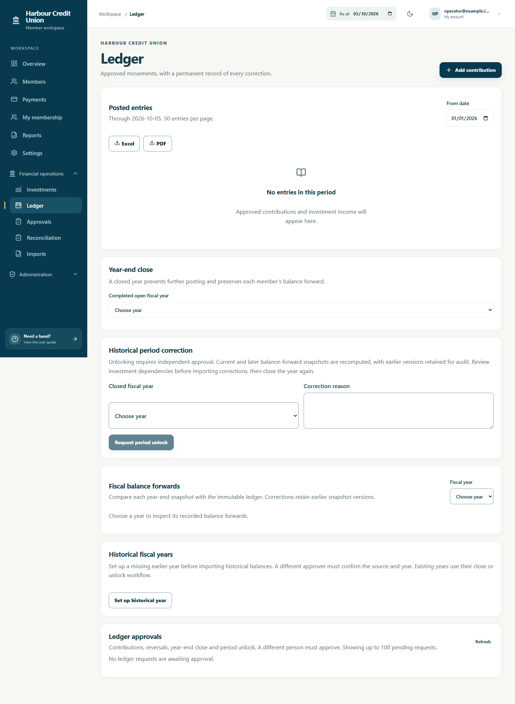
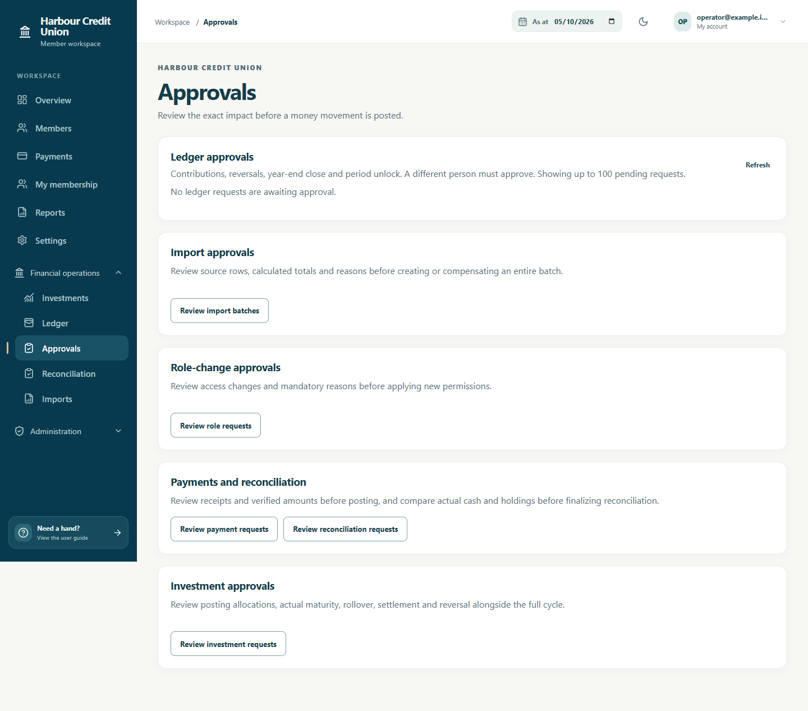
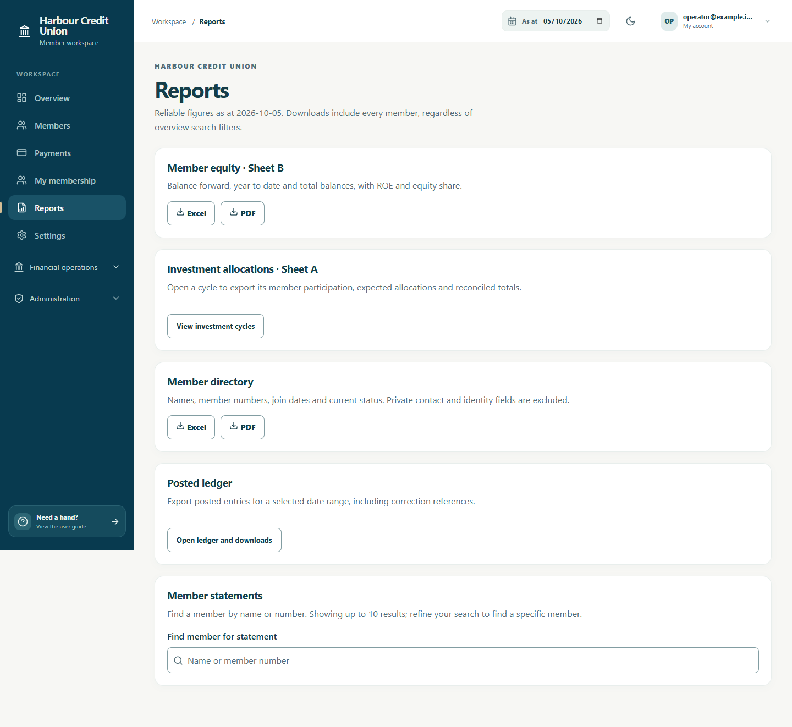
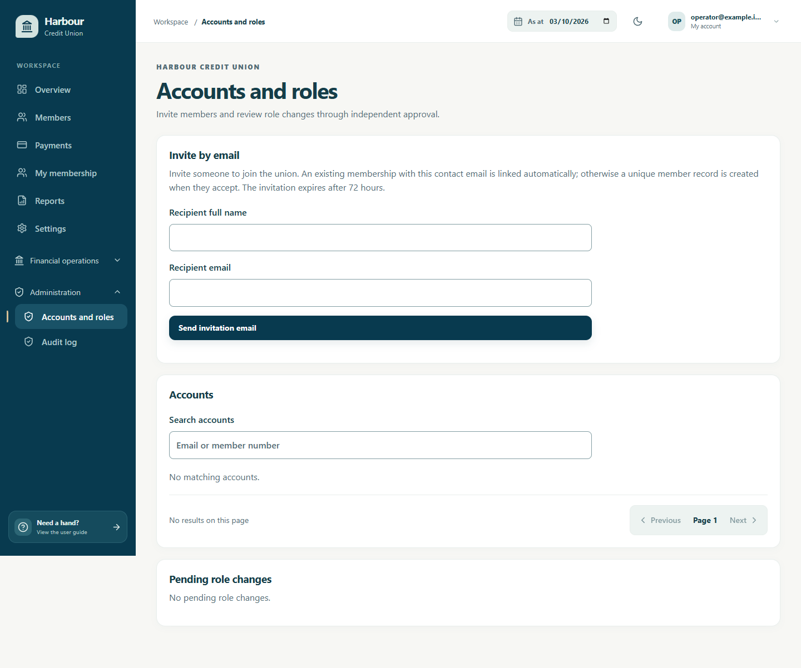
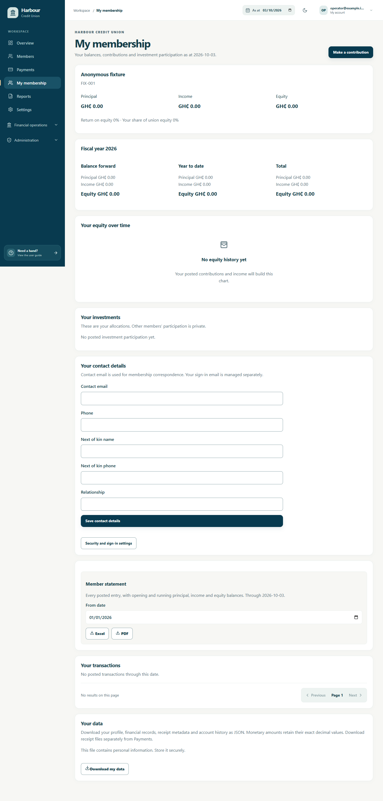
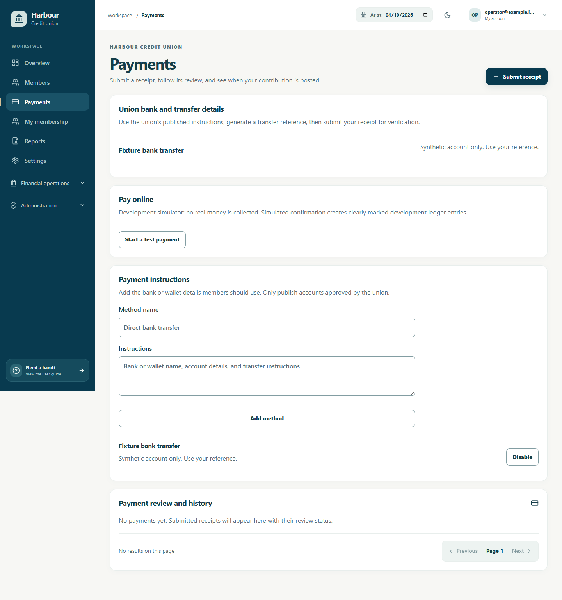

# User guide

The examples below use an isolated synthetic operator fixture. No client workbook/member details appear in the screenshots. Actual menus and controls follow each account's current permissions.

## Treasurer

Use Financial operations → Ledger to record a contribution, Investments to preview treasury-bill allocations, and Reconciliation to compare holdings/cash. A money movement is pending until independent approval. Manual receipts are verified in Payments against the actual evidence/amount; the verifier cannot supply their own independent approval. Never use the labelled development payment simulator for real money.

## Approver

Open Financial operations → Approvals, review the exact proposed amount, source and consequences, then approve or reject. The maker cannot approve their own request; rejection needs a reason. Role and import approvals appear in their respective authorized screens. Recheck stale-source warnings instead of repeatedly retrying.

## President and vice president

Use Overview/Reports for as-at balances and oversight. Permissions determine whether approval controls are available. Authorized period unlocks require a reason and independent approval; review corrected snapshots before reclosing a year. Current production leadership roles differ from the developer's all-permission override.

## Administrator

Use Administration → Accounts and roles for email invitations and reviewed role assignments. An invitation can start a prospective membership; do not invent a member record merely to send an invitation. Recipients choose their own password and protected method. Initial leadership roles cannot expire automatically, and linked leadership members cannot be deactivated until their guarded role removal is approved. Settings contains union policies and separate personal security cards. Audit access follows AUDIT_READ; request addresses are restricted investigation metadata.

## Member

My membership shows your balances, contact details, statement downloads and transactions. Payments provides the union's published bank/wallet instructions. Generate a transfer reference, include it in your transfer, then submit your receipt; your balance changes after staff verification and independent approval. Security methods and recovery codes are managed in Settings. Monthly charts are suppressed where imported summaries cannot establish monthly history.

## Membership and sign-in

Open the invitation link, set a strong password, then sign in and choose TOTP, a passkey, or configured Google sign-in. TOTP includes a QR code and manual key; keep recovery codes privately. Google remains gated until credentials are configured.

My membership shows only the account's linked member: principal, income, equity, fiscal-year figures, monthly history, allocations and posted transactions. Select an as-at date and download a ranged statement. Contact email, phone and next-of-kin details can be edited; contact email is separate from sign-in email.

## Contributions

Payments offers secure hosted checkout when configured. A browser return does not confirm payment: posting follows signed webhook and server verification. Pending payments can be checked or resumed. The development simulator is labelled and collects no real funds.

For manual transfers, choose published instructions, enter amount/purpose, and create a reference before sending funds. Include it in transfer narration. Enter the actual paid date, attach JPEG/PNG/plain PDF proof up to 10 MB, then submit. A treasurer verifies the evidence and actual amount. A different approver must approve before principal is credited. Original submitted values remain traceable. Confirmation PDF is available after posting.

## Staff workflows

Members supports generated unique numbers, search, pagination, versioned edits and status changes. Accounts and roles supports invitations and reviewed role changes. Replacing an invitation invalidates the old link. Recipients choose their password; no default password is shipped.

Ledger supports current-day contributions, exact compensating reversals and prior-year close. Requests affect balances only after the required distinct approvals. Makers cannot approve their own requests. Rejection requires a reason; makers can cancel pending requests.

Investments supports exact allocation previews, reasoned participation edits, posting, actual maturity gains/losses, rollover and settlement. Approved current-day reversal retains revision history and exact income compensation. Returned drafts require fresh posting approval; active rollover dependencies must be resolved first.

Reconciliation compares current ledger equity/open investment cost with actual holdings/cash. Notes and differences are retained in an immutable snapshot. A separate approver finalizes it; changed sources require a fresh review. Bank settlement matching remains pending.

Reports exports dashboard, allocation, ledger, public member directory and authorized statements to Excel/PDF. Private downloads and report generation are audited.

Audit log is available with AUDIT_READ permission. Choose a date range and optional exact action, entity type, actor ID or record ID, then apply filters. CSV downloads use the applied filters across all pages, with a 5,000-event limit; narrow the filters for larger results. The screen and export contain event metadata, excluding sensitive change payloads. System events have no actor account.

## Settings, errors and development

Organization policies share one Settings block, including union details, payment limits, approvals, fee policy and rollover. Personal security settings retain their own cards. Required approvals apply to new requests; pending requests retain their original count. Online payments retain their starting fee policy. Vinette by Vinyl links to the creator's GitHub profile.

Read toast details before retrying. Stale edits require reload; money is never credited optimistically. Offline mode requests reconnection and stores no account data or receipts. DEMO memberships and simulator postings are fictitious. The local dev account's permission override still preserves maker-checker separation.

## Imports

Open Imports with import permission, download the appropriate CSV template and fill its columns in order. Keep member numbers as text, dates as YYYY-MM-DD and amounts as plain decimals. Excel users can save a single worksheet as XLSX, replacing formulas with values. Limits are 5 MB and 1,000 data rows. Member numbers can be blank for generation at approval; private contact/identity fields are encrypted in staging.

Ledger templates accept OPENING_BALANCE (PRINCIPAL or INCOME) and SEED/ADDITION (PRINCIPAL). Opening amounts support four decimal places; contributions support two. Only opening income may be negative. References must be unique. An optional final TOTAL row has TOTAL in member_number and the source total in amount. All other totals-row fields should be blank.

Run the dry run, resolve every row error and compare the calculated total with your source. Enter the source/reason, then confirm the exact checked file. No memberships or entries are created until independent approval. Review batch shows the submitted public impact; private contact/identity values are excluded. Makers can cancel pending requests. Reversal requires a reason and independent approval: ledger entries are exactly compensated today, while unused imported members are deactivated. Accounts or financial dependencies block member-batch reversal.

## Historical period correction

An authorized PRESIDENT can request a closed year's unlock from Ledger, with a reason. A different eligible approver must review it; the maker cannot approve it. Rejection or cancellation leaves the period closed. Unlock preserves earlier snapshots and recomputes that year's balance forward and all later recorded snapshots. Submit the reviewed correction through Imports, obtain independent approval, verify the updated balances, then request year-end close again.

An import date that would change an existing or archived investment cycle's ratios is blocked. Use the explicit Historical contributions workflow for a reviewed contribution impact; moved-cycle correction is handled by that reviewed workflow, and historical investment/allocation imports use their own template. Do not alter dates to bypass the warning.

Overview's Fiscal year selector changes the shared as-at date. Balance-forward verification identifies missing or mismatched prior-year snapshots and open correction periods. The Ledger balance-forward panel shows each member's snapshot, revision and ledger comparison. Overview figures always derive from the immutable ledger.

## Download your data

In My membership, use Download my data for a JSON file containing your profile, financial records, own allocation revisions, snapshot history and account metadata. Decimal amounts remain exact strings. It contains personal information; keep it securely. Receipt metadata is included; download the actual files separately from Payments. Passwords, authenticator secrets and session tokens are excluded.

Historical contribution impact preview and both cycle-handling options are available, as is independently reviewed account recovery. Historical investment/allocation imports, reviewed receipt amendments and archived-cycle correction are available. Production delivery gates remain open. See PROGRESS and CHECKLIST.

## Account security and lost devices

Open Settings to manage your own security methods. Passkeys lists registration/last-use dates and whether your provider reports a backup. Add a spare passkey before relying on a single device.

To remove a lost passkey, change your password or replace recovery codes, confirm your current password and either a fresh authenticator/recovery code or a verified passkey. Removing a passkey or changing the password signs out every device. You cannot remove your last protected sign-in method. If the last passkey was your preference and an authenticator remains, the preference changes to authenticator.

If your authenticator is lost, sign in using your password, choose **Use a recovery code**, and enter one of your saved codes. Each code works once. If you can still use a passkey, that also provides an independent sign-in route. In Settings, **Replace recovery codes** invalidates every old code; save the new codes securely before closing the panel. They are not saved in browser storage or shown again.

If you forget your password, use **Forgot password?** on Sign in. The response is the same whether an eligible account exists. The registered email receives a single-use link valid for 30 minutes when SMTP delivery is configured. Resetting your password signs out all devices and retains your authenticator, passkeys and Google identity. You must still use your protected sign-in method.

If every protected method and recovery code is lost, contact an administrator. In Accounts and roles, **Account recovery** requires documented identity verification and approval by a different person with approval and role-assignment permissions. The affected account cannot approve its own recovery. Approval revokes every session and protected method, then queues a 30-minute link to the registered email. After setting a new password, sign in and set up a new protected method. Changes to account security invalidate a pending review; changes to the registered email invalidate an issued link. Expired links cannot be replayed or retried for delivery.
# Historical contributions and email delivery

In Ledger, open **Add contribution**, select **Use a historical date**, enter the original date and correction reason, then preview the impact. Review every affected cycle before selecting a handling option.

- **Future cycles only** keeps existing allocations unchanged. Supply the next cycle start after all affected purchases. The original date remains recorded. If the next start is in the future, wait until it arrives.
- **Reverse and repost** requires backdating, investment-writing and cycle-repost permissions, with affected years independently unlocked. Approval archives old allocations, compensates/replaces income at original maturity dates, recalculates later cycles and recomputes snapshots. Explicit participation edits and exclusions remain respected.

A different eligible approver reviews the bound impact. Changed financial source requires cancellation and a fresh preview/request. Resolve pending dependencies first. Moved/reversed cycles retain their original evidence; income changes are recorded at the original maturity date and offset at the approved compensation date. Missing compensation evidence blocks recomputation until it is resolved.

Administrators can inspect **Email delivery** in Accounts and roles. Filter queued, failed and sent messages, and confirm an eligible failure retry. This queues delivery; SMTP must be enabled. Sent messages cannot be retried. Expired or consumed invitation links require a new invitation. Message payloads and private links are excluded from the administration screen.

## HEIC receipts

Choose a JPEG, PNG, PDF or HEIC receipt up to 10 MB. HEIC photos are converted to JPEG on your device before upload. Keep the form open while the preparation toast is showing. Images must be at most 25 megapixels. If conversion fails or times out, use a smaller image or a JPEG/PDF copy. Submitted receipts still require staff verification and independent approval before your balance changes.

### Set up a missing historical year

In Ledger, leadership can choose **Set up historical year**, select a year before the current year and record the source reason. An independent checker reviews the request in Approvals. Approval opens the missing calendar year without adding money. Import or contribute historical amounts through their separate reviewed workflows afterward. An existing closed year uses **Unlock year** instead.

### Review financial changes

In Audit log, expand **Financial changes** on a recorded financial event to compare its changed fields before and after. Amounts retain their original decimal precision. Creation starts from None; deletion ends at None. The transaction number groups changes committed together. Downloads include these safe changes, while free-text notes, bank references and private account/member payloads stay excluded. Changes recorded before migration V37 have event metadata only; the system does not invent historical audit values.

### Replace a receipt or review its history

In Payments, choose **Replace receipt** while a manual payment is submitted or awaiting more information. Upload the clearer receipt and choose **Replace and return for verification**. The payment amount, purpose and paid date stay unchanged, the earlier file remains available and staff must verify again. A changed form or a payment that has reached verification cannot overwrite reviewed evidence. If saving fails after upload, retrying uses that same uploaded replacement.

**Receipt history** opens a read-only drawer/sheet for your authorized payment even after posting. It includes the current receipt and retained earlier files. Approvers can review the history without gaining permission to replace proofs. Your own JSON export includes the revision metadata. Rejected payments are terminal; start a separate submission rather than changing rejected evidence.

## Match gateway payments with bank settlements

Open **Finance → Reconciliation**. The settlement section lists gateway-confirmed payments with their gross amount, provider fee and expected bank receipt. **Match bank settlement** opens the shared desktop drawer or mobile bottom sheet. Enter the bank's actual settled amount/date and evidence notes; explain a difference and avoid including personal account details.

A separate eligible approver opens **Review settlement match** and checks the bank evidence before confirming or rejecting with a reason. The maker cannot approve their own request. Pending requests can be cancelled by their maker. Changed payment/settlement data requires a fresh review. After approval, **Correct settlement match** creates another reviewed record; earlier evidence stays in the history.

Matching records a bank receipt, without crediting the member twice or altering their contribution. The expected net always subtracts the provider fee from gross, whether fees are borne by the union or the member. Differences remain visible for reconciliation. This is reviewed manual matching; obtain actual bank/provider statements separately. It does not connect to bank accounts or make payouts.

## Historical payments and investment records

In Payments, review an old receipt and enter the actual received amount. Staff with historical posting permission can preview its original paid date, choose future-only treatment or affected-cycle reposting, explain the evidence, and request separate approval. The checker sees the impact before posting. Cancel and review again if the financial source changes.

In Imports, select Historical investment and allocations and download its CSV template. Use one cycle per file, oldest first, with participating member numbers and repeated institution, reference, dates and totals. Omit zero participants. Optional supplied share columns and a final TOTAL row must match the exact preview. Blank actual proceeds means expected income; entering received proceeds posts earned income at maturity. Never import that same earned income twice through an opening balance and a cycle. If dates were not recorded, obtain confirmed dates or explicitly documented assumptions before submitting.

In Investments, select a matured cycle and use Historical earned-income corrections to revise received proceeds. Preview every changed member and dependent cycle, then obtain independent approval. Original economic dates are preserved; required fiscal periods must be open or independently unlocked. Approved revision history now opens the original allocation evidence in a drawer/sheet.

Organization policies include personal-data retention. Confirm missing legacy departure dates, preview eligible inactive memberships and obtain independent permanent-removal approval. This cannot be undone. The screen reports receipt files still awaiting physical deletion; downloads are already blocked. The owner separately manages original files and older backups.

### Correct an original ledger amount

In Ledger, an eligible original manual contribution or opening balance offers **Correct on original date**. Preview and explain the exact opposite entry, including every dependent investment impact, then request independent approval. The original entry remains in the ledger. Submit any corrected replacement separately using a reviewed contribution or import; do not treat this as a refund of a provider payment. Closed affected periods must be independently unlocked.

### Correct moved or reversed investment income

Open an archived revision in Investments. Its original dates and allocations remain read-only. Eligible received-income revisions offer a correction form: enter the corrected received proceeds and preview. The approved economic correction is recorded separately from the original revision, with linked earned-income adjustments at maturity and exact offsets at its compensation date. Later affected cycles and snapshots are recomputed. The archive shows the approved correction history and your data export includes your own shares and adjustment links.

## Union branding and account policy

Administrators use the organization policies block in Settings to upload a public PNG logo, choose a primary colour with readable white button text, select GH₵ or GHS display and set password minimum/idle timeout. Passwords remain at least 12 characters with common-password checks. An idle-timeout change applies to existing sessions on their next request. Display preferences do not convert money. The Storage and backups card reports configuration only; obtain the last successful off-site backup/restore record from the operator.

Investments supports institution/reference search, status filters, sorting and paginated results. Page/status/sort survive a page reload; identifying search text is never placed in the URL.
